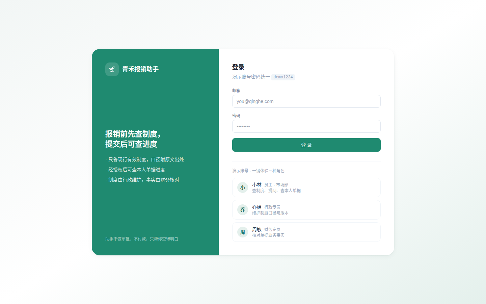

# 青禾报销助手

> 报销前先查制度，提交后可查进度。

员工不该靠翻群聊记录或问同事来搞清楚「住宿一晚能报多少」。青禾报销助手解决两件很具体的事：

1. **制度自助查询（只读）** —— 一句话提问，答案只来自**现行有效**的制度条款，附原文出处；制度没覆盖的问题明说「查不到」，不推测、不编造。
2. **经授权查询本人单据** —— 首次查单需本人同意（可随时撤回），只能看到**自己**的报销单走到哪一步；助手不审批、不付款。



## 谁负责什么

权限落在服务端接口层，不只是文案：

| 角色 | 是谁 | 能做什么 | 不能做什么 |
| --- | --- | --- | --- |
| 员工 | 小林 | 查现行有效制度、一句话提问、经授权查**本人**单据 | 查不到别人的单据；不能认定业务事实 |
| 行政专员 | 乔姐 | 新建制度、发布新版、设定生效日期、废止 | 不能修改单据的业务事实 |
| 财务专员 | 周敏 | 核对单据业务事实（金额/事由/凭证）、驳回、标记已打款 | 不能修改制度口径 |

四条硬边界，代码里有对应拦截：

1. **口径只认现行有效版本。** 检索引擎只索引「状态为现行有效且今天落在生效区间内」的条款。演示数据中差旅制度有 v3.1（已失效，住宿统一 400）与 v3.2（现行，分档 500/400/300），问住宿标准只会答 v3.2。
2. **单据仅本人可见。** 拿别人的单据号直接访问返回 403；财务/行政因核对需要可读全部。
3. **员工查单先授权。** 未授权时接口返回 `CONSENT_REQUIRED`；授权可随时撤回。
4. **状态机不许跳步。** 单据只能按「材料审核 → 财务核对 → 待打款 → 已打款」推进，驳回必须写意见；越权角色（员工/行政）碰核对接口直接 403。

## 功能速览

| 页面 | 说明 | 截图 |
| --- | --- | --- |
| 首页 | 能力入口、热门问题、口径责任说明 | [home](docs/screenshots/home.png) |
| 制度库 | 分类筛选、搜索；员工只见现行有效版本 | — |
| 智能问答 | 对话式提问，命中条款 + 出处卡片，点击跳原文；问答留痕仅本人可见 | [assistant](docs/screenshots/assistant.png) |
| 我的单据 | 首次进入授权弹层 → 单据列表 → 提交报销单（金额由明细自动汇总） | [my-claims](docs/screenshots/my-claims.png) |
| 单据详情 | 完整流转时间轴 + 业务事实核对卡（未核对明确标注「以财务核对结论为准」）+ 适用制度一键跳原文 | [claim-detail](docs/screenshots/claim-detail.png) |
| 制度维护台（乔姐） | 新建制度、**发布新版**（旧版自动失效留档）、废止 | [policy-admin](docs/screenshots/policy-admin.png) |
| 财务核对台（周敏） | 待核对队列、四项核对要点、核对意见、驳回、标记已打款 | [finance](docs/screenshots/finance.png) |

## 跑起来

需要 Node 18+，不需要装数据库。

```bash
npm run setup        # 安装 server + client 依赖
npm run dev          # 终端 1：起服务端 http://localhost:3001
npm run dev:client   # 终端 2：起前端 http://localhost:5173（已配代理转发 /api）
```

开发模式访问 http://localhost:5173 。

**生产模式**（单进程，服务端直接托管前端构建产物，适合部署）：

```bash
npm run build        # 构建前端
npm start            # http://localhost:3001
```

演示账号，密码统一 `demo1234`（登录页可一键填充）：

| 邮箱 | 角色 | 体验什么 |
| --- | --- | --- |
| `lin@qinghe.com` | 员工 · 小林 | 查制度、提问、授权后查本人单据、提交报销单 |
| `qiao@qinghe.com` | 行政专员 · 乔姐 | 制度维护台：发布新版看旧版自动失效 |
| `zhou@qinghe.com` | 财务专员 · 周敏 | 核对台：开始核对 → 通过/驳回 → 打款 |

重置演示数据：`npm run db:reset` 后重启服务端。

## 跑测试

```bash
npm run dev          # 先起服务端
npm run test:api     # 另开终端
```

31 项断言，覆盖：有效制度可见性（失效版进不了员工列表与检索）、检索口径可回溯（引用指向 v3.2 而非 v3.1）、无关问题不硬答、查单授权与撤回、越权访问拦截、三类角色权限边界、状态机跳步拦截、发布新版后问答口径自动切换。

## 目录结构

```
.
├── package.json               # 根脚本：setup / dev / build / start / test:api / db:reset
├── docs/screenshots/          # 页面截图
├── server/                    # Express 服务端
│   ├── src/
│   │   ├── server.js          # 入口；生产模式托管 client/dist
│   │   ├── config.js          # 端口 / JWT / 可选大模型配置（读 .env）
│   │   ├── store.js           # JSON 文件存储（原子写入，零原生依赖）
│   │   ├── seed.js            # 演示数据：3 账号、6 部制度（含版本沿革）、5 张单据
│   │   ├── auth.js            # JWT + bcrypt + requireRoles 角色门禁
│   │   ├── retrieve.js        # 中文二元组 + BM25 检索，只索引现行有效条款
│   │   ├── llm.js             # 可选大模型接入；失败自动降级为制度原文摘录
│   │   └── routes/            # auth / policies / assistant / claims
│   └── scripts/
│       ├── smoke.mjs          # 31 项接口冒烟测试
│       └── reset.mjs          # 重置演示数据
└── client/                    # Vite + React 18 + TailwindCSS
    └── src/
        ├── App.jsx            # 路由 + 登录态 + 角色守卫
        ├── components/        # Layout（角色感知侧边栏）/ ui（徽章、弹窗、空态）
        └── pages/             # Login / Home / Policies / PolicyDetail / Assistant
                                # MyClaims / ClaimNew / ClaimDetail / PolicyAdmin
                                # FinanceAdmin / Me
```

## 检索与大模型

不引向量库。制度条款用**中文二元组切词 + 简化 BM25** 打分，叠加条款自带关键词的精确命中加权，并设最低分数门槛（低于 2.5 分视为噪声、宁可不答），几十到几百条条款的量级够用。

大模型是**可选**的：在 `server/.env` 里配置任意 OpenAI 兼容接口即可开启（参照 `.env.example`）：

```
OPENAI_BASE_URL=https://api.openai.com/v1
OPENAI_API_KEY=sk-xxxx
OPENAI_MODEL=gpt-4o-mini
```

- 开启后：模型只依据检索到的条款作答（system prompt 限定），答案仍附条款引用卡片。
- 未配置或调用失败：自动降级为「制度原文摘录」模式，把检索到的条款原文拼出并明确标注未接模型，**绝不编造内容**。

## 数据说明

当前为**本地体验模式**：身份、制度、单据、授权、问答留痕全部存在 `server/data/db.json`（已 gitignore），首次启动自动灌入种子数据。`seed.js` 里的制度是演示口径，不是任何公司的真实制度。

接数据库时只需替换 `server/src/store.js` 的读写实现为等价的数据库查询（并按角色做行级权限），路由与页面代码无需改动。

## 许可

MIT。
